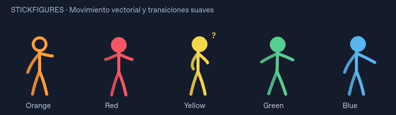
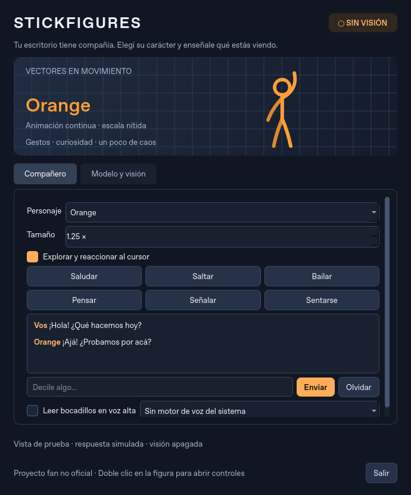

# Stickfigures · Desktop AI

Modo de escritorio nuevo para este proyecto fan no oficial: figuras vectoriales,
animación continua y una IA opcional que conversa y reacciona a capturas del monitor.





Vista de prueba de la interfaz; la respuesta mostrada es simulada.

El repositorio original contiene el motor Java compilado (`AlansStickfigures.jar`
y archivos `.class`), sin sus fuentes Java. Por eso este modo tiene un motor propio
en Python y Qt, y se ejecuta por separado del Shimeji original. Sus PNG y XML
siguen disponibles para ejecutar la versión anterior.

## Ejecutarlo en Windows

Instalá [Python 3.10 o posterior](https://www.python.org/downloads/) y, desde la raíz
del repositorio, ejecutá en PowerShell:

```powershell
py -m venv .venv
.\.venv\Scripts\python.exe -m pip install -e .
.\.venv\Scripts\python.exe -m desktop_ai
```

También podés abrir `StartDesktopAI.bat` después de instalar las dependencias.
Java no es necesario para este modo. En Linux/X11 o macOS:

```sh
python3 -m venv .venv
.venv/bin/python -m pip install -e .
.venv/bin/python -m desktop_ai
```

Se verificaron la interfaz, el render y la captura en un escritorio virtual Linux/X11.
Windows y macOS requieren verificación en esos sistemas; en macOS hay que permitir
la grabación de pantalla. La captura de Wayland no está implementada: usá X11.

## Animación y personajes

- Render vectorial con antialiasing, sin ampliar los PNG de 128 × 128.
- Temporizador de aproximadamente 60 FPS, movimiento según tiempo transcurrido y
  mezcla progresiva entre posturas. La velocidad no depende de la tasa de render.
- Nueve perfiles: Orange, Red, Yellow, Green, Blue, Purple, TCO, TDL y victim.
- Once acciones: reposo, caminar, saludar, saltar, bailar, sentarse, pensar,
  señalar, celebrar, sorprenderse y dormir.
- Sigue el cursor con la orientación del cuerpo. Arrastrá la figura para moverla;
  al soltarla vuelve suavemente al suelo. Doble clic abre los controles y clic
  derecho abre su menú. Cerrar los controles pausa la visión y deja la mascota
  activa; «Salir» termina la aplicación.

Este primer modo muestra una figura por vez. No incorpora todavía todas las
interacciones del Shimeji original, como trepar ventanas, pelear o abrazar otras figuras.
Los movimientos vectoriales son nuevos; no son una restauración de cada animación
original ni una reproducción exacta de los videos.

## Conectar un modelo con visión

La aplicación puede funcionar sin IA. Para conversar o reaccionar con un modelo,
abrí **Modelo y visión** y elegí una conexión.

### Ollama

Instalá [Ollama](https://ollama.com/), iniciá su servidor y descargá un modelo que
acepte imágenes, por ejemplo:

```sh
ollama pull qwen2.5vl:7b
```

La configuración inicial usa `http://localhost:11434` y `qwen2.5vl:7b`.
El rendimiento y la memoria necesaria dependen del modelo y de tu equipo.
Ollama recibe las imágenes mediante `/api/chat` y se le pide salida JSON.

### API compatible con OpenAI

Elegí **API compatible con OpenAI**, indicá la URL base (por ejemplo,
`https://api.openai.com/v1`), el nombre del modelo con visión y la clave.
La opción inicial es `gpt-4.1-mini`. La conexión utiliza `/chat/completions`,
imágenes `image_url` y `response_format: {"type":"json_object"}`. El proveedor
elegido debe admitir esas tres capacidades; no todas las APIs compatibles las admiten.

La clave puede ingresarse en el campo de contraseña durante la sesión o mediante
la variable de entorno `OPENAI_API_KEY`. No se guarda en las preferencias ni en
el repositorio. Para un servidor compatible local que no pide autenticación,
dejá el campo vacío y no configures esa variable.

### Darle visión

1. Elegí el monitor. Opcionalmente usá **Elegir región** y arrastrá un rectángulo;
   Escape cancela la selección.
2. Activá **Permitir que el modelo vea este monitor o región**. El indicador de
   visión aparece en los controles y junto a la mascota.
3. Pulsá **Mirar y reaccionar ahora**, o escribí un mensaje con visión habilitada.
4. Para reacciones periódicas, activá la opción automática. El intervalo inicial
   es de 20 segundos después de completar cada respuesta y sólo hay una consulta
   en curso. Un error detiene las consultas automáticas.

La captura se reduce a un máximo de 1280 píxeles de lado y se envía como JPEG
al servidor configurado. El modelo recibe una imagen por consulta, no un video
continuo. Puede tardar en responder y puede interpretar mal detalles pequeños.
La ventana de controles o la propia mascota pueden aparecer dentro del área
elegida; podés mover los controles o seleccionar una región distinta.

Con visión apagada, los mensajes son sólo texto. Cambiar de destino, monitor o
región pausa la visión. Pausarla descarta las respuestas pendientes, pero una
captura que ya se envió no se puede retirar del servidor. Capturas y conversación
se mantienen en memoria; las preferencias guardan sólo modelo, URL, personaje,
tamaño e intervalo. Las políticas de retención del proveedor remoto son propias
de ese proveedor.

## Personalidad y forma de hablar

El [system prompt](prompts/system.txt) define una interpretación breve y gestual:
curiosidad, humor físico, cooperación y pequeñas travesuras. Cada personaje tiene
un perfil diferente en `brain.py`. Se puede editar el prompt y se vuelve a leer
en la próxima consulta.

La respuesta esperada es un objeto como:

```json
{"speech":"¡Ajá! ¿Probamos por acá?", "action":"point", "emotion":"curious", "target_x":0.7}
```

Los bocadillos contienen hasta 180 caracteres. `target_x` es una coordenada
horizontal relativa al área capturada; se convierte al monitor correspondiente.
El modelo sólo elige gestos y el desplazamiento de la mascota. La aplicación no
ejecuta comandos, hace clic ni escribe en otras aplicaciones a partir de su salida.
Las acciones desconocidas se reemplazan por reposo y las coordenadas se acotan.

**Leer bocadillos en voz alta** usa las voces TTS del sistema, sin un segundo
servicio de IA. Podés elegir una voz instalada, preferentemente en español. Si no
hay motor o voces disponibles, la opción queda deshabilitada. No se incluye una
voz canónica o clonada de los personajes.

## Desarrollo y verificación

```sh
QT_QPA_PLATFORM=offscreen .venv/bin/python -m unittest discover -s tests -v
```

Para probar la captura real en X11:

```sh
DISPLAY=:99 QT_QPA_PLATFORM=xcb .venv/bin/python -m unittest discover -s tests -v
```

Las pruebas cubren ambos protocolos HTTP con un servidor simulado, validación de
acciones, interpolación, independencia de FPS, interfaz, captura por región,
descarte de respuestas pendientes y ausencia de capturas en turnos de texto.
No requieren una clave de API ni descargan un modelo. La inferencia con un modelo
real y la voz del sistema deben verificarse con la configuración del equipo final.

Archivos principales:

| Archivo | Responsabilidad |
| --- | --- |
| `app.py` | Controles, consultas en segundo plano y ciclo de sesión |
| `motion.py` | Poses, transiciones y desplazamiento |
| `pet.py` | Render vectorial y ventana transparente |
| `screen.py` | Captura y selección de región |
| `brain.py` | Proveedores, personalidades y validación de respuestas |
| `prompts/system.txt` | Comportamiento y protocolo del modelo |
